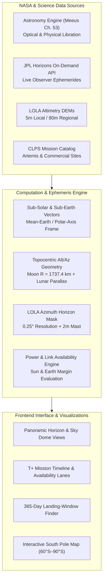

# LunaSight — Lunar Landing Site Navigator
### 2026 NASA Space Apps Challenge Solution

[](https://lunar-apex.vercel.app)
[](https://mallikarjunr444-gif.github.io/lunar-apex-/)
[](https://github.com/mallikarjunr444-gif/lunar-apex-/actions/workflows/ci.yml)
[](https://opensource.org/licenses/MIT)

> **Challenge:** [Lunar Landing Site Navigator](https://www.spaceappschallenge.org/2026/challenges/lunar-landing-site-navigator/)  
> **Event:** 2026 NASA Space Apps Challenge  
> **Subjects:** Human Exploration, Moon, Software, Space Exploration  
> **Difficulty:** Advanced / Intermediate  

---

## Executive Summary

Missions to the Moon’s south pole face extreme lighting and communication constraints. Planning lunar landings requires intricate coordination between science teams (seeking PSRs, water ice, and volatile traps) and engineering teams (requiring continuous solar array power and direct line-of-sight to Earth). 

While raw data tools such as NASA's LROC QuickMap, Moon Trek, and the JPL Horizons System provide high-precision information, their complex and disparate interfaces make rapid scenario comparison cumbersome. When schedule adjustments, launch slips, or hardware constraints shift a target date or location, mission planners need to evaluate trade-offs in seconds—not hours.

**LunaSight** is an intuitive, mission-grade web platform and API that bridges the gap between deep planetary ephemerides and agile decision-making. It enables mission planners, educators, and the public to:
1. **Compare landing sites and dates side-by-side** in real time.
2. **Visualize Sun and Earth positions** relative to the true local horizon (including LOLA-derived topography).
3. **Assess power generation potential** and **direct-to-Earth communication windows** with instant pass/fail validation against mission duration requirements.
4. **Scan up to a full year of touchdown dates** with an automated Landing-Window Finder to discover actionable launch opportunities.

---

## Live Deployments

- **Primary Application & Serverless API (Vercel):** [https://lunar-apex.vercel.app](https://lunar-apex.vercel.app)
- **Static Frontend (GitHub Pages):** [https://mallikarjunr444-gif.github.io/lunar-apex-/](https://mallikarjunr444-gif.github.io/lunar-apex-/)
- **Interactive Multi-Scenario Demo:** [Open Pre-configured Comparison](https://lunar-apex.vercel.app/#w=30&m=7&u=0&e=0&l=1&v=panorama&s=-89.780403,-156.196951,2026-11-15T13:00,0,Shackleton%20Rim%20crest%20(LOLA)|-86,0,2026-11-15T13:00,0,Malapert%20massif|-80.13,1.44,2026-11-15T13:00,0,IM-1%20Odysseus%20(Malapert%20A))

---

## Challenge Objectives & How LunaSight Solves Them

| Challenge Objective | LunaSight Implementation & Features |
|---|---|
| **Interactive Site Selection & Comparison** | • Curated library of **44 sites** spanning candidate Artemis III regions, CLPS mission targets (Intuitive Machines IM-1/IM-2, Astrobotic VIPER), historic Apollo sites (11, 12, 14, 15, 16, 17), and international landings (ISRO Chandrayaan-3, CNSA Chang'e-4/5/6, Roscosmos Luna 25).<br>• Custom lunar coordinates input (latitude, longitude, elevation).<br>• Side-by-side comparison of up to 5 concurrent scenarios. |
| **Date & Time Flexibility (Schedule Slips)** | • Precise touchdown UTC date and time controls.<br>• Instant schedule slip nudges: **±1 h, ±1 d, ±7 d, ±30 d (1 lunation)**.<br>• "Sync to first" scenario and "Now" buttons to test launch window shifts for the exact same site. |
| **Sun & Earth Position Visualization** | • Dual view modes: **360° Panoramic strip** (azimuth × elevation) and **180° Zenith Polar Sky Dome**.<br>• True angular disc sizing for Sun (0.53°) and Earth (1.9°–2.1°).<br>• Real-time countdowns to sunset/sunrise and Earthset/Earthrise refined to seconds.<br>• Real-time 1 m vertical mast shadow length projection. |
| **Power & Communication Assessment** | • Solar elevation angle tracking & solar irradiance proxies (flat horizontal vs. Sun-tracking vertical arrays).<br>• Earth line-of-sight elevation tracking accounting for optical and physical libration.<br>• Configurable operational thresholds: Minimum Sun elevation, Minimum Earth elevation, and Upper-Limb vs. Disc-Center sunrise convention.<br>• Direct pass/fail scorecard against mission lifetime requirement (e.g. 7-day, 14-day, 30-day missions). |
| **Multiple Visualization Approaches** | • **Interactive 2D Polar Map:** Stereographic projection from 60°S to 90°S with clickable sites, interactive coordinate placement, and scenario markers.<br>• **Panoramic Sky View:** Azimuth-elevation horizon profile.<br>• **Polar Sky Dome:** Hemispherical projection showing celestial trajectories. |
| **Temporal Dynamics & Animation** | • **Interactive Mission Timeline (T+0 to T+60 d):** Solid line for Sun, dashed line for Earth.<br>• **Availability Lanes:** Color-coded timelines for Solar Power, Direct-to-Earth Link, and Joint Availability.<br>• Playable mission clock with variable playback speeds (1 h/s, 6 h/s, 1 d/s, 3 d/s) and drag-to-scrub responsiveness.<br>• Dynamic hover tooltips showing instantaneous elevations across all scenarios. |
| **Landing-Window Finder** | • Automated sweep across **90, 180, or 365 days** of touchdown dates.<br>• Calculates uninterrupted sunlight, continuous Earth contact, and joint availability duration for every candidate landing moment.<br>• Highlights actionable launch windows and allows one-click adoption of optimal landing dates. |
| **Accessibility Across Skill Levels** | • **For Mission Planners:** Provenance-bearing JSON Evidence Report, CSV comparison export, and one-click live cross-check against NASA/JPL Horizons API.<br>• **For Educators & Public:** Educational tiles explaining lunar day dynamics (29.5 d synodic period, airless horizon physics, low polar Sun angles, libration wobbles). |

---

## Technical Approach & Planetary Geometry Architecture



### 1. Ephemeris & Selenographic Geometry
- **Sub-Solar & Sub-Earth Points:** Computed using Meeus *Astronomical Algorithms* Chapter 53 (including optical libration, physical libration terms $\rho$, $\sigma$, $\tau$, and planetary nutation).
- **Coordinate Reference Frame:** Mean-Earth/Polar-axis (ME) frame consistent with LOLA, QuickMap, and Moon Trek.
- **Topocentric Elevation & Azimuth:** Spherical Moon vector geometry ($R_{Moon} = 1737.4\text{ km}$) accounting for Earth's lunar parallax (up to $\sim 0.26^\circ$).
- **Airless Physics:** Since the Moon has no atmosphere, there is zero atmospheric refraction or twilight. The horizon is strictly defined by geometric tangent rays plus local topographic elevation.
- **Solar Limb Rule:** Sunrise/sunset occurs when the Sun's upper limb ($+0.267^\circ$ angular radius) crosses above the local terrain horizon.

### 2. Topography & LOLA Horizon Profiles
Polar results without topography are overly optimistic because crater rims and massif ridges cast long shadows. LunaSight integrates high-resolution horizon profiles derived from NASA Lunar Orbiter Laser Altimeter (LOLA) data (via SIGHTLINE project data, Apache-2.0):
- **Resolution:** $0.25^\circ$ azimuth spacing (1,440 discrete azimuth horizons).
- **Sampling:** 5 m local DEM out to 12 km, merged with 80 m regional DEM out to 300 km for a 2 m surface rover/lander mast.
- **Preset Pinned Sites:** Shackleton Rim crest, Connecting Ridge, and de Gerlache Rim.
- **Custom Topography:** Users can upload custom horizon masks in CSV/TXT format (`azimuth, elevation`) or specify a uniform terrain elevation mask.

---

## Integration with NASA & Partner Resources

LunaSight directly connects with every primary resource identified by NASA Space Apps:

### 1. NASA LROC QuickMap
- **Dynamic Context Links:** Every scenario card features a **"QuickMap here"** action that deep-links directly into Arizona State University's LROC QuickMap.
- **Pre-configured Layers:** Automatically opens with the project's recommended Earth-shadow layer stack and simple cylindrical projection re-centered on the card's exact coordinates.

### 2. NASA Moon Trek
- **3D Relief Exploration:** Each scenario provides a **"Moon Trek"** trigger that copies formatted coordinates (`lat, lon`) to the clipboard and launches NASA's interactive 3D lunar visualization portal.

### 3. NASA / JPL Horizons System
- **Live Ephemeris Cross-Check:** Each scenario card features an on-demand **"Check with JPL Horizons"** trigger. The backend queries NASA JPL's Horizons REST API (`COMMAND='10'` for Sun, `'399'` for Earth, `CENTER='coord@301'`) from the exact lunar surface geodetic coordinates and elevation, comparing local screening calculations with mission-grade JPL ephemerides.
- **Dual Data Modes:** Toggle the entire platform between the fast local analytic model and live JPL Horizons positions.

### 4. Canadian Space Agency (CSA) Moon Exploration
- **Mission Context Section:** Features a dedicated "Canada & the Moon" portal in the resources view highlighting Canada's key lunar initiatives:
  - **Canadarm3** for the Lunar Gateway
  - **Lunar Gateway** collaboration
  - **Canadian Utility Rover** program
  - **Artemis Campaign** participation & astronaut assignments
  - **LEAP** (Lunar Exploration Accelerator Program)
  - Canadian lunar science & technologies overview

---

## Architecture & REST API

LunaSight is built with zero external runtime dependencies for maximum reliability, speed, and clean-room security.

### REST Endpoints

| Endpoint | Method | Description |
|---|---|---|
| `/api/health` | `GET` | Service status, uptime, and NASA API key configuration. |
| `/api/lunar-phase` | `GET` | Current Moon illumination fraction, phase angle, lunar age in days, and next New/Full Moon timestamps. |
| `/api/sites` | `GET` | Complete catalog of 44 curated landing sites, including CLPS candidate regions and sources. |
| `/api/sites/:id` | `GET` | Single site detail metadata by identifier. |
| `/api/sunrise-next` | `GET` | Precise upcoming sunrise, sunset, earthrise, and earthset times and countdowns for any site. |
| `/api/landing-windows`| `GET` | Server-side scan across candidate landing dates calculating multi-day uninterrupted power/comm windows. |
| `/api/timeline` | `GET` | High-frequency topocentric Sun/Earth elevations, azimuths, and window metrics over 1–90 days. |
| `/api/compare` | `GET` | Side-by-side evaluation of up to 5 sites or custom coordinates. |
| `/api/evaluate` | `GET` | Ranked mission assessment with scoring for power, communications, and joint viability. |
| `/api/horizons/compare` | `POST` | Live comparative check between local model and JPL Horizons observer ephemeris. |
| `/api/terrain/profiles` | `GET` | Pinned 0.25° LOLA horizon profiles (1,440 samples) for south-pole reference sites. |
| `/api/elevation-profile`| `GET` | 360-degree elevation profile for a requested site. |
| `/api/apod` | `GET` | NASA Astronomy Picture of the Day integration. |
| `/api/stats` | `GET` | Telemetry, LRU cache hit/miss rates, and service metadata. |

### API Performance & Protocol Support
- **HTTP/2 & Gzip Compression:** Automated gzip compression for JSON payloads.
- **Conditional Requests (ETags):** Full `ETag` and `If-None-Match` support returning `304 Not Modified` for cached responses.
- **CORS & Preflight:** Comprehensive `OPTIONS` preflight support for cross-origin integration.
- **Configurable Base URL:** Controlled via `frontend/js/config.js` (`window.LUNASIGHT_API_BASE`).

---

## Local Development & Testing

### Prerequisites
- Node.js >= 20

### Quick Start
```bash
# Clone the repository
git clone https://github.com/mallikarjunr444-gif/lunar-apex-.git
cd lunar-apex-

# Start the local server
npm start
# Open http://localhost:3000 in your browser
```

### Verification & Testing
```bash
# Run syntax and static analysis checks
npm run check

# Execute comprehensive unit test suite
npm test
```

The automated test suite verifies:
- Mathematical accuracy against Meeus Chapter 53 worked examples.
- Libration agreement with Astronomy Engine and NAIF SPICE conventions.
- Historic Apollo 11 touchdown solar elevation and orientation.
- Polar solar confinement ($\pm 1.54^\circ$) and Earth libration limits ($\pm 7^\circ$).
- LOLA horizon profile interpolation and wrapping.
- Live JPL Horizons API adapter normalization.
- HTTP API endpoints, ETags, caching, and 304 handling.

---

## Provenance & Attribution

- **NASA / JPL Horizons:** Courtesy NASA/JPL-Caltech Solar System Dynamics Group.
- **LROC QuickMap:** Developed by Arizona State University / Applied Coherent Technology Corp under contract to NASA.
- **NASA Moon Trek:** Developed by NASA Solar System Exploration Research Virtual Institute (SSERVI) and JPL.
- **LOLA Horizon Profiles:** Sourced from Barker et al. (2021) via the [SIGHTLINE](https://github.com/WarRinOP/sightline) project (Apache-2.0).
- **CLPS Mission Sites:** Attributed to the [CLPS Lunar Mission Browser](https://github.com/localizedprojects/CLPS-MOON-BROWSER) dataset (MIT, commit `9801046`).
- **Astronomy Engine:** Cosmological position algorithms by Don Cross (MIT).
- **Canadian Space Agency:** Educational summaries sourced from the CSA Moon Exploration portal.

---

## License

This project is licensed under the **MIT License** — see the [LICENSE](file:///Users/malikarjunr/lunar-apex-/LICENSE) file for details.

*Disclaimer: NASA does not endorse any non-U.S. Government entity and is not responsible for information contained on non-U.S. Government websites. For non-U.S. Government websites, participants must comply with any data use parameters of that specific website.*
